# Tonefield

A music-driven visualizer for the desktop. Six models, each a physics or algorithmic system tuned to look striking, move with the music: a built-in generative band, a MIDI keyboard or controller, or a song you load drives them through their notes, spectrum and loudness, macros and modulation. Pick a model, shape it with sliders, and play with it using the mouse.

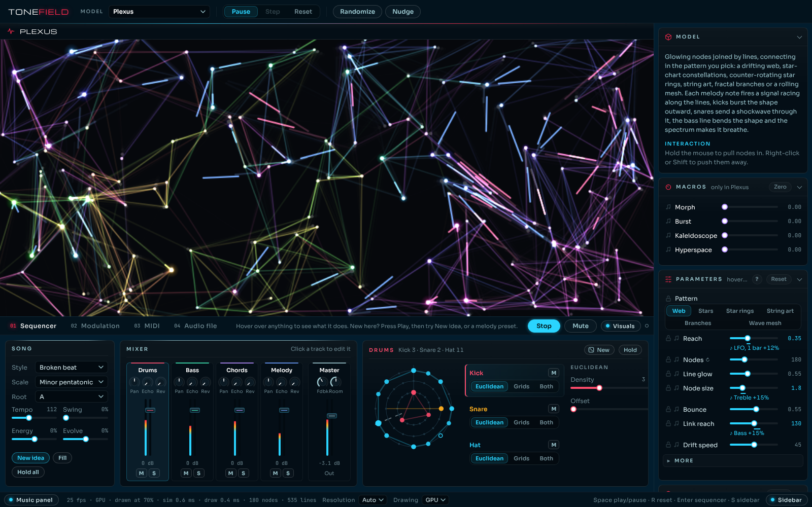

Built with [Tauri 2](https://tauri.app) (Rust shell, native webview) and TypeScript. Every model draws with WebGL on the GPU, with Canvas 2D kept as a fallback. It runs on Linux (Arch, Debian/Ubuntu, AppImage), macOS (Apple Silicon and Intel) and Windows 10/11.

## Install

Download the file for your system from the [latest release](https://github.com/thomas-nelson23/tonefield/releases/latest). After that, the **Update** button in the app installs new versions for you.

| System | File | |
| --- | --- | --- |
| Arch, CachyOS, EndeavourOS, Manjaro | `tonefield-<version>-1-x86_64.pkg.tar.zst` | [Arch](#arch-based-distros) |
| Debian, Ubuntu | `Tonefield_<version>_amd64.deb` | [Debian / Ubuntu](#debian-and-ubuntu) |
| Any Linux, no install | `Tonefield_<version>_amd64.AppImage` | [AppImage](#appimage) |
| macOS (Apple Silicon and Intel) | `Tonefield_<version>_universal.dmg` | [macOS](#macos) |
| Windows 10/11 (x64) | `Tonefield_<version>_x64-setup.exe` | [Windows](#windows) |

### Arch-based distros

Download the package to a file first, then install that file:

```sh
curl -LO https://github.com/thomas-nelson23/tonefield/releases/download/v0.3.4/tonefield-0.3.4-1-x86_64.pkg.tar.zst
sudo pacman -U ./tonefield-0.3.4-1-x86_64.pkg.tar.zst
```

(Swap in the version from the latest release.) Don't give `pacman -U` the URL directly: pacman then looks for a `.sig` signature file next to it, which releases don't have, and stops with a 404. Launch **Tonefield** from your app menu, or run `tonefield`. Uninstall with `sudo pacman -R tonefield`.

To build the package from source instead, the repo ships a [`PKGBUILD`](packaging/arch/PKGBUILD):

```sh
sudo pacman -S --needed base-devel git
git clone https://github.com/thomas-nelson23/tonefield.git
cd tonefield/packaging/arch
makepkg -si
```

`makepkg -s` pulls in everything it needs (Rust, Node, `webkit2gtk-4.1`, `alsa-lib`). To update a source build, `git pull`, then `makepkg -sif` in `packaging/arch`.

### Debian and Ubuntu

```sh
sudo apt install ./Tonefield_0.3.4_amd64.deb
```

### AppImage

Runs without installing anything. It needs FUSE 2 (`sudo pacman -S --needed fuse2` on Arch, `sudo apt install libfuse2` on Ubuntu):

```sh
chmod +x Tonefield_*.AppImage
./Tonefield_*.AppImage
```

On Arch the pacman package is the better fit: the AppImage is built on Ubuntu and bundles its own libraries.

### macOS

1. Open the disk image and drag **Tonefield** into **Applications**.
2. Open Tonefield. The app isn't signed with an Apple Developer ID, so the first time macOS says it can't verify it: click **Done**, open **System Settings › Privacy & Security**, scroll down and click **Open Anyway**, then confirm. After that it opens normally, including after in-app updates.

Releases before 0.3.4 were Apple Silicon only and could say the app "is damaged"; `xattr -dr com.apple.quarantine /Applications/Tonefield.app` in Terminal fixes those.

### Windows

Run the setup `.exe`. It installs for your user only, so it needs no admin rights, and adds Start menu and uninstall entries. The installer isn't code-signed, so SmartScreen says "Windows protected your PC" the first time: click **More info**, then **Run anyway**. The app runs on Microsoft Edge WebView2, which Windows 11 and up-to-date Windows 10 already have; if it's missing, the installer downloads it.

### Troubleshooting

- **Blank window or a crash on start on Linux (common with NVIDIA):** the app sets `WEBKIT_DISABLE_DMABUF_RENDERER=1` itself, so this shouldn't happen. If you need the DMA-BUF renderer back, launch with `WEBKIT_DISABLE_DMABUF_RENDERER=0 tonefield`.
- **Low frame rate on a big screen:** set **Resolution** in the bottom bar lower (Auto lowers it only while the frame rate drops under 55), and check **Drawing** is on GPU.

## The window

The layout follows Photoshop:

- **Options bar** across the top: the model picker, Pause / Step / Reset, and the dice: **Visuals**, **Music**, **Undo** and **Redo** (see Explore below).
- **Canvas** in the middle.
- **Panels** down the right, each foldable: **Explore** (the dice), the model's description and how to interact with it, its **Macros**, its **Parameters** and the **Global controls**.
- **Music panel** under the canvas, with the sequencer, modulation, MIDI and audio file tabs.
- **Bottom bar**: switches to show or hide the music panel and the sidebar, frame rate with simulation and draw times, **Resolution**, **Drawing** (GPU or CPU), and the **Update** button.

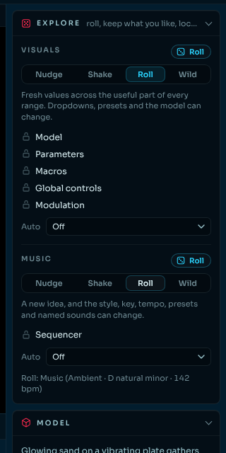

**Explore** is the way in when the controls look like a lot. It has two sets of dice, one for the visuals and one for the music, so a look you like survives a new tune and the other way round. Press **Roll** on the Visuals side (or `D`) and the picture changes at once, as far as the level you picked allows; press **Roll** on the Music side (or `M`) and the song does. Each side has its own level: **Nudge** moves every slider a little from where it is; **Shake** moves them further and, on the music side, starts a new idea in the same style; **Roll** lands fresh values across every useful range and can switch the presets and the model, or the style, key and tempo; **Wild** goes anywhere, rebuild sizes and new synth sounds included. Each category has a padlock, so once a roll gives you a model, a look or a tune you like, lock it and keep rolling the rest: **Model**, **Parameters** (the padlock beside each slider still applies), **Macros**, **Global controls** and **Modulation** on the visuals side, the **Sequencer** on the music side (mutes, holds and the mixer are never rolled). Each category has a die of its own too, for rolling just that one. Inside the sequencer, every control has a padlock as well, so the tempo, the key, the style or a sound you've settled on stays put while the rest of the music rolls. While the music plays, a music roll waits for the next bar and starts the new song on the downbeat. Every roll on either side can be undone (`Z`) and redone (`Shift+Z`), forty rolls back, and each side's **Auto** rolls it again every so many bars while the sequencer plays, without ever rebuilding the model, so a show can run by itself with the picture and the song changing at their own pace. A line under the panel says what the last roll did.

**Global controls** apply to every model and stay put when you switch: colour scheme (follow the melody, rainbow, fire, ice or bioluminescent), hue shift and cycle, saturation, brightness, contrast and negative; gravity direction and strength; energy; trails; and tunnel zoom and spin, which make the trails fly outward and turn for a feedback-tunnel effect. The presets dropdown sets them all at once, with ten built in (Neon tunnel, Inferno, Deep sea, Noir and others) and **Save** for your own.

**Macros** are four 0..1 knobs per model that each push several parameters at once.

**Parameters** opens on the five to eight controls that change the picture most; the finer ones are under **More**, with the ones that rebuild the model (counts, resolution) marked ↻. Hover a control for what it does, or press **?** to show the descriptions under every control. Double-click a slider to put it back to its default, and **Reset** puts the whole model back; a dot after a label marks a value that is off its default. Values are saved per model. Some controls only appear when they apply (Plexus shows the sliders for the pattern you picked; Cymatics shows Turning for the round plate), and Living ink's **Chemistry** pad moves its feed and kill rates together. The ♪ beside any slider adds a modulation route to it.

Keyboard: `Space` pause or play the visuals and the music, `D` roll the visuals, `M` roll the music, `Z` undo a roll and `Shift+Z` redo it, `Enter` play or stop the sequencer, `R` reset the model, `.` step one frame while paused, `S` show or hide the sidebar.

## Models

| Murmuration | Branches | Living ink |
| --- | --- | --- |
| 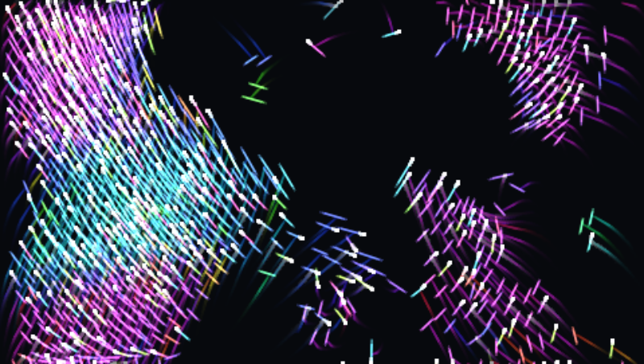 | 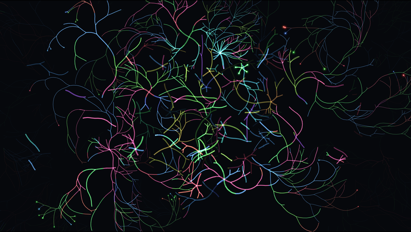 | 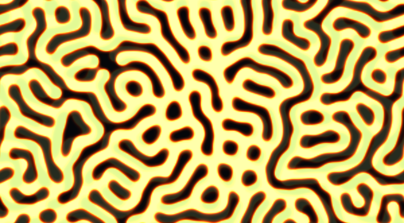 |
| **Cymatics** | **Plexus** | **Facets** |
| 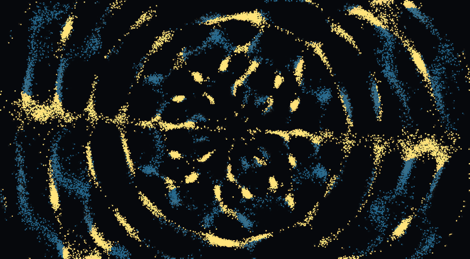 | 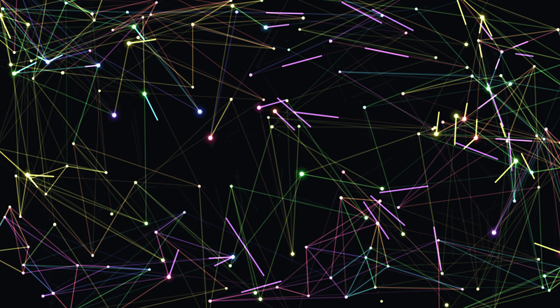 | 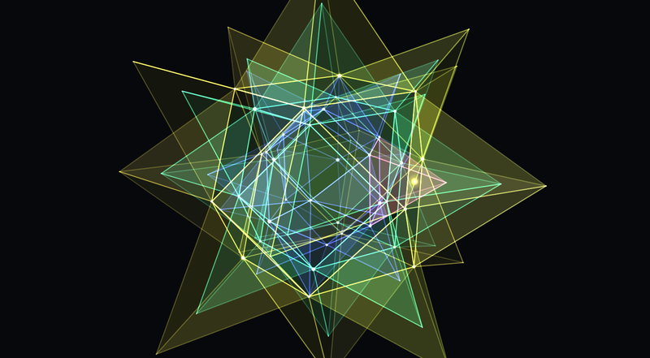 |

| Model | What the music does | Interaction |
| --- | --- | --- |
| Murmuration | A flock of light streaks chases each note and takes its colour, which spreads bird to bird; chords colour part of the flock, kicks scatter it, snares spin vortices | Hold to attract, right-click to scatter |
| Branches | Fractal trees sprout all over the screen, grow out fork by fork, stand a while and dissolve, while new ones grow in the gaps and from the tips of the old, so it keeps spreading and changing like Living ink. Each tree sprouts, blooms or creeps as it grows and retracts, crumbles or fades as it goes. Kicks surge the growth and sprout trees, snares crumble them, notes sprout trees where they land, the bass opens and closes the forks, chords colour the trees | Click or drag to plant trees, right-drag to dissolve them |
| Living ink | Reaction–diffusion that grows where the spectrum is loud; notes seed blooms, the palette follows the melody | Drag to seed (what you draw stays fed for Brush hold seconds), right-drag to wipe |
| Cymatics | Glowing sand on a vibrating plate morphs to a new figure with every note; the round plate draws turning mandalas. The plate fills the screen, and with gravity on the sand streams through the figure endlessly | Drag to stir the sand |
| Plexus | Glowing nodes joined by lines in a pattern you pick: web, constellations, star rings, string art, fractal tree or wave mesh. Nodes spring between patterns, notes fire signals along the lines, kicks burst the shape, the bass bends it | Drag to pull nodes in, right-drag to push them away |
| Facets | 3D polyhedra (ten shapes, from tetrahedron to torus) turning in glass, solid or wireframe, with nested shells. Every few bars the shape subdivides into a sphere, grows spikes, shatters, folds open or twists and morphs into the next shape. Kicks burst the faces apart, snares knock it spinning, notes light faces by pitch, chords tint the shells, the spectrum grows spikes | Drag to spin it, right-click to burst it apart |

Shift works in place of right-click everywhere.

## Music

### Sequencer

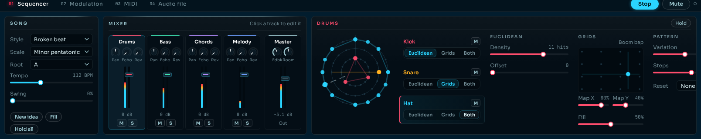

A generative band: instead of programming steps, you steer each part and it writes and evolves the music itself. Hover over anything and the line in the tab bar says what it does. The tab has three columns.

- **Song**: style (broken beat, four on the floor, half-time, ambient), scale, root, tempo and swing; **Energy**, which makes every track busier or sparser at once, and **Evolve**, how much every track changes as it plays; plus **New idea** (fresh patterns, melody and progression), **Fill** and **Hold all** (freeze everything).
- **Mixer**: a strip each for Drums, Bass, Chords and Melody with a fader and meter, Pan, Echo and Reverb sends, Mute and Solo, and a Master strip. Muting a track also stops the visuals reacting to it; the **Mute** button at the top silences the audio only. Click a strip to edit that track.
- **The selected track**, each with a **New** die (a fresh pattern, same settings) and its own **Hold**. Bass, chords and melody switch between their **Pattern** and their **Sound**:
  - **Drums**: kick, snare and hat, drawn as three rings. Each drum plays in one of three modes. **Euclidean** spreads its **Density** hits evenly round the bar, with **Steps**, **Offset** and **Reset** (back to the start every so many bars); drag a ring round to turn it. **Grids** reads its pattern off a drum map in the spirit of Mutable Instruments' Grids: straight to broken left to right, sparse to busy bottom to top, with **Fill** setting how much of it plays. **Both** plays the two together. Each drum also has Variation, Volume, Pan, Pitch, Decay and a tone knob (Punch, Snap, Bright).
  - **Bass**: a style (root pulse, off-beat, octave bounce, syncopated, walking, drone), Density, Range (root only up to chord tones and passing notes) and Variation. It follows the chords.
  - **Chords**: jazz, pop, dance or epic, each with its own progressions and harmonic rhythm (how long chords hold, and pickups into the next). **Rhythm density** adds changes, **Rhythm variation** varies the pattern each pass, **Variation** swaps in style-typical substitutes, and **Déjà vu** (from Mutable Instruments' Marbles) decides how often a variation comes back instead of a new one. Epic now and then lifts the whole song up a step for a pass.
  - **Melody**: a random sequencer after Mutable Instruments' **Marbles**. A clock plays **Coin**, **Bursts** or **Steady** rhythms at a rate you pick, with **Density** and **Jitter**. Each note is drawn from a range set by **Spread** and **Bias**, and **Steps** sets how hard it snaps, from gliding scale notes to only the chord's root. **Déjà vu** (Marbles' own loop, ported) brings the last few notes back more and more until they loop, over the rhythm, the notes or both, with **Loop length**. The view on the left draws both loops and the note range, and doubles as a Bias/Spread pad. Seven presets start you off: Drift, Wander, Riff, Sparkle, Chant, Shuffle and Chaos.

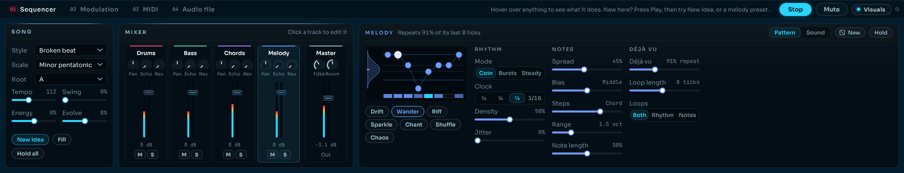

Bass, chords and melody each play a voice ported from Mutable Instruments' **Plaits**, set in the track's **Sound** view. Six named sounds per track give a starting point (Round, Acid or Deep sub for the bass; String pad, Organ or Choir for the chords; Folded lead, Bell or Flute for the melody, and others), and under them are the voice's eight engines (virtual analog, waveshaper, FM, grain formant, additive, string machine, plucked string, modal resonator), Harmonics, Timbre and Morph with envelope amounts, and the low-pass gate's Decay and Colour. Chords add **Inversion**, **Strum**, Attack and a tempo-synced Wobble; bass adds a Sub and Glide. The voices run in an AudioWorklet, off the main thread. Master holds the shared echo and reverb.

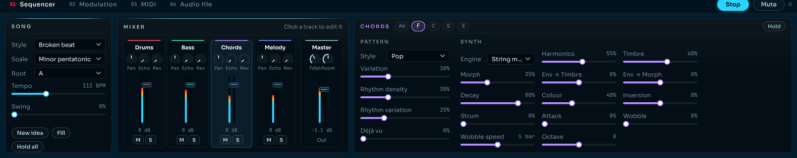

Every hit, bass note and chord reaches the current model, and every control can be mapped to a MIDI knob.

### Modulation

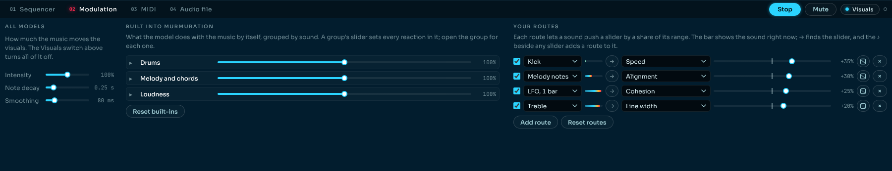

Two columns:

- **Built into this model**: what the model does with the music by itself, such as Kick → Burst outward, grouped into Drums, Melody and chords, and Loudness. Each group folds to one strength slider that sets every reaction in it; open it for each reaction's own strength, on/off switch and delete button. A reaction's strength is also the control for what it does: Branches' Crumble row, say, sets how many trees each snare breaks apart. **Restore built-ins** brings back any you deleted and **Reset built-ins** puts them all back at 100%.
- **Your routes**: a source pushes a slider, macro or global control by a share of its range, each with a live meter, a dice that rolls a random target and amount, and → to find the slider in the sidebar. Sources are the drums, melody, bass notes and chords, tempo-synced LFOs, audio levels (overall, bass, mids, treble), a few advanced ones, and MIDI (mod wheel, pitch bend and any CC) once a controller is connected. A ♪ under a sidebar slider names what is pushing it and opens the route; the ♪ beside a slider adds one.

**Intensity** scales every reaction and route on every model, **Note decay** sets how long a hit keeps pushing, **Smoothing** stops the audio levels flickering a slider, and the **Visuals** switch in the music panel's header turns it all off. Routes and built-in settings are saved per model.

### MIDI

Pick input devices, play notes through the melody's Plaits voice, and map knobs with **MIDI learn** (click it, click a slider, macro or global control, move a knob). Mappings for macros, global controls and the sequencer carry across models.

MIDI goes through the Rust side ([`src-tauri/src/midi.rs`](src-tauri/src/midi.rs), using `midir`) because the Linux and macOS webviews don't support Web MIDI; Windows uses the same path through WinMM. On Linux it needs ALSA. In a plain browser (`npm run dev`) the app falls back to Web MIDI where the browser has it.

### Audio file

Play a song: its bass, mids, treble and level become modulation sources, and its kick drums can trigger note reactions.

## Updates and releases

The **Update** button in the bottom bar checks this repo's [releases](https://github.com/thomas-nelson23/tonefield/releases) at launch and whenever you click it, and lights up when a newer version is out. Clicking it shows the release notes and installs the right file for how you installed Tonefield:

- **pacman package**: downloads the `.pkg.tar.zst` and runs `pacman -U` behind your desktop's password prompt.
- **.deb**: the same with `apt-get install`.
- **AppImage**: swaps the new AppImage in place.
- **Windows**: runs the new setup `.exe`, which reopens Tonefield when it's done.
- **macOS**: opens the new disk image to drag into Applications.
- **Anything else** (dev builds): links to the release page.

Releasing is a version bump: `npm run bump 0.3.5` sets the version in every file that carries it. When that lands on `main`, CI builds every platform and publishes them as release `v0.3.5`. Pushes that keep the version publish nothing.

## Building from source

Prerequisites: Node 20+, Rust (stable, via [rustup](https://rustup.rs)) and the [Tauri system dependencies](https://tauri.app/start/prerequisites/) for your OS.

```sh
# Arch / CachyOS
sudo pacman -S --needed base-devel webkit2gtk-4.1 librsvg alsa-lib rust nodejs npm

# Debian / Ubuntu
sudo apt install libwebkit2gtk-4.1-dev libappindicator3-dev librsvg2-dev patchelf libasound2-dev

# macOS
xcode-select --install

# Windows: the Visual Studio C++ Build Tools and Rust's MSVC toolchain
```

```sh
npm install
npm run tauri dev     # desktop app with hot reload
npm run dev           # or just the UI in a browser at http://localhost:1420
npm run typecheck
npm run tauri build   # Linux: .deb + .AppImage   macOS: .app + .dmg   Windows: setup .exe
```

For a universal Mac build add `-- --target universal-apple-darwin`; for just the Windows installer, `-- --bundles nsis`. Bundles land in `src-tauri/target/release/bundle/`.

## Adding a model

Every model implements `SimulationModel` from [`src/models/types.ts`](src/models/types.ts). The host app owns the canvas, the main loop, the parameter sliders and pointer routing, so a model only describes its parameters and implements `reset`, `step` and `render` (plus optional `renderGL`, `onPointer`, `onNote`, `resize` and `stats`).

1. Create `src/models/myModel.ts` exporting a `ModelDefinition`:

   ```ts
   import type { ModelDefinition, SimulationModel } from "./types";

   class MyModel implements SimulationModel {
     reset(view, params) { /* build state */ }
     step(dt, params, music) { /* advance state by dt seconds */ }
     render(g, view, params, music) { /* draw with the 2D context */ }
     renderGL(gfx, view, params, music) { /* the same picture on the GPU */ }
   }

   export const myModel: ModelDefinition = {
     id: "my-model",
     name: "My model",
     category: "Particles",
     description: "What it shows.",
     params: [
       { kind: "number", key: "strength", label: "Strength", min: 0, max: 10, step: 0.1, default: 1 },
     ],
     create: () => new MyModel(),
   };
   ```

2. Add it to the list in [`src/models/registry.ts`](src/models/registry.ts).

`renderGL` draws through `Gfx` ([`src/gl/gfx.ts`](src/gl/gfx.ts)): `feedback` for the shared trails, then `line`, `disc`, `ring`, `glow`, `quad4`, `rect`, and `upload` + `image` for pixel buffers, with `blend("add")` for the glowing look. The host uses it whenever WebGL works and Drawing is set to GPU, and falls back to `render` otherwise. Canvas 2D fills every shape on the CPU in the Linux webview, so `renderGL` is what keeps a busy model fast.

Sliders, checkboxes and dropdowns (`kind: "choice"`) are generated from `params`. Give a param a `group` to put it in a foldable group and a `description` for its tooltip. Mark it `resetOnChange: true` if changing it should rebuild the simulation (e.g. a particle count).

To make a model musical:

- Read the `MusicFrame` passed to `step` and `render`: drum and melody envelopes (`kick`, `snare`, `hat`, `tone`), audio bands (`level`, `bass`, `mid`, `treble`), a 48-bin log `spectrum`, a `wave` snapshot, the beat clock (`beats`, `pulse`), the last note's `hue` and `pitch`, and an overall `energy`. Values are already scaled by Intensity and by each reaction's strength.
- List what the model does with the music in `reactions` (`{ source: "bass", label: "Swell", text: "The ring swells with the bass" }`). Each becomes a built-in row in the Modulation tab.
- Set `paintsBackground: true` to draw your own background, e.g. with `Feedback` from `models/lib/visual.ts` for trails and the tunnel effect.
- Implement `onNote(note, params)`. A `NoteEvent` has the MIDI `note`, `velocity` (0..1), a `role` (`"kick"`, `"snare"`, `"hat"` or `"tone"`) and `x`, the note's place in its range from 0 (lowest) to 1 (highest), handy as a left-to-right position. `noteHue` in `models/lib/music.ts` gives a consistent colour per pitch.
- Add `macros`: each is a 0..1 knob with `targets: [{ param, amount }]`, where `amount` is a fraction of that param's range.
- Add default `modulations`, e.g. `{ source: "kick", target: "strength", amount: 0.2 }`, so music does something before anyone opens the Modulation tab.

Number params without `resetOnChange` can be modulated; the model always receives the modulated values in `params`.

## Project layout

```
src/
  main.ts            app shell: canvas, main loop, input, model switching, bottom bar
  roll.ts            the dice levels (Nudge, Shake, Roll, Wild) and the helpers every roll shares
  gl/gfx.ts          WebGL drawing used by every model's renderGL
  models/
    types.ts         the model interface
    registry.ts      list of available models
    boids.ts         Murmuration: flocking light streaks
    branches.ts      Branches: fractal trees that grow and dissolve across the screen
    reaction.ts      Living ink: Gray-Scott reaction-diffusion
    chladni.ts       Cymatics: sand figures on a vibrating plate
    plexus.ts        Plexus: nodes joined by lines in six patterns
    facets.ts        Facets: 3D polyhedra that evolve with the music
    lib/grayscott*   Living ink's simulation, run in a Web Worker
    lib/visual.ts    trails / tunnel feedback, glow sprites, colour schemes
    lib/raster.ts    pixel buffer + palettes for grid models
    lib/gravity.ts   shared gravity directions
    lib/music.ts     note colours and helpers for musical models
  music/
    studio.ts        music panel: sequencer, mixer, modulation matrix, MIDI learn, audio file
    sequencer.ts     generative drums, bass, chords and melody with lookahead scheduling
    grids.ts         the Grids-style drum map
    audio.ts         drum kit, mixer, effects, file player, band and spectrum analyser
    plaits/          Plaits engines and voices (dsp.ts), run in an AudioWorklet (worklet.ts)
    modulation.ts    modulation sources and how they combine with sliders and macros
    globals.ts       global controls and presets
    midi.ts          MIDI input (Tauri events, or Web MIDI in a browser)
  ui/
    controls.ts      builds parameter controls (with padlocks) from a model's spec
    explore.ts       the Explore panel: visual and music dice, category locks, undo and auto-roll
    knob.ts          mixer knobs and faders
    grade.ts         global colour controls applied on the GPU
    panels.ts        foldable sidebar panels
    updater.ts       the Update button and its popup
src-tauri/           Rust/Tauri desktop shell, bundle config, MIDI input (src/midi.rs) and updates (src/update.rs)
packaging/arch/      PKGBUILD for the pacman package
scripts/bump-version.mjs  sets the version everywhere for a release
```

## Credits

The bass, chord and melody voices in `src/music/plaits/` are a TypeScript port of parts of [Plaits](https://github.com/pichenettes/eurorack/tree/master/plaits) and stmlib by Emilie Gillet (Mutable Instruments), used under the MIT licence; the copyright notice is kept at the top of `dsp.ts`. The drum map in `src/music/grids.ts` is original code in the spirit of Mutable Instruments' Grids, and Déjà vu borrows its idea from Marbles.

The look follows the Deep Ocean theme of Thomas's home dashboard. Its fonts, [Sora](https://fonts.google.com/specimen/Sora), [JetBrains Mono](https://www.jetbrains.com/lp/mono/) and [Michroma](https://fonts.google.com/specimen/Michroma), are bundled from Fontsource under the SIL Open Font License.
